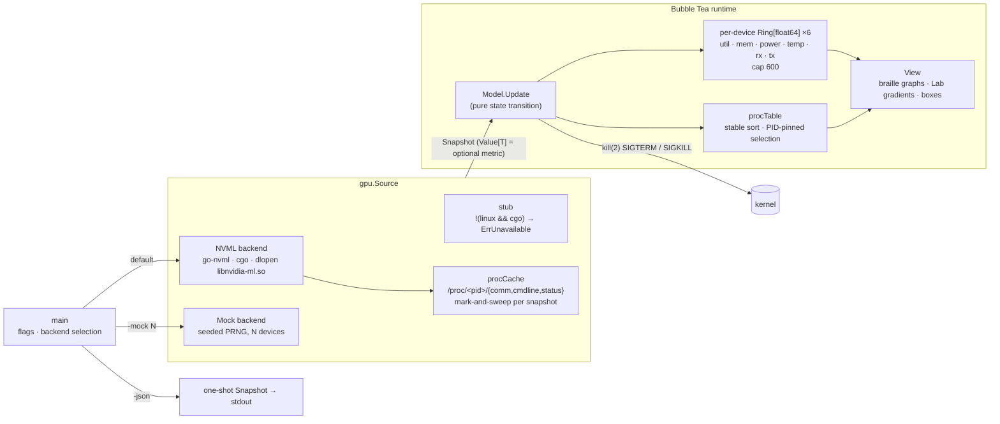
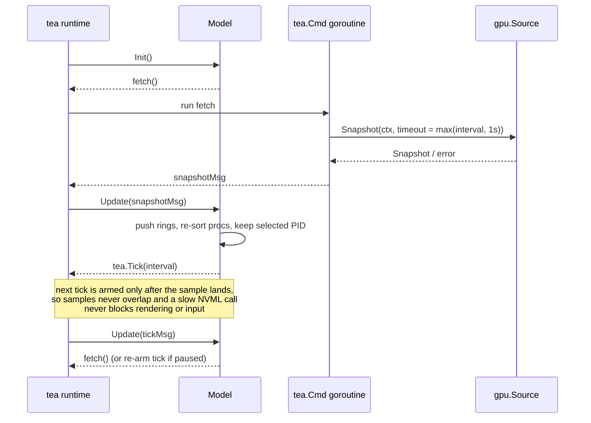

<p align="center">
  
</p>

# zvtop

A [btop](https://github.com/aristocratos/btop)-inspired terminal monitor for NVIDIA GPUs, written in Go.

[](https://github.com/zvdy/zvtop/actions/workflows/ci.yml)
[](https://pkg.go.dev/github.com/zvdy/zvtop)
[](LICENSE)


## Features

- **Braille history graphs** for utilization, VRAM, power, temperature and PCIe throughput, with two samples per cell and gradient coloring
- **Live meters** for GPU, VRAM, temperature, power, fan, memory bandwidth, NVENC/NVDEC, clocks and performance state
- **Process table** showing per-process SM/encoder/decoder usage and VRAM. You can sort it, scroll it and send signals from it, and the selection stays on the same PID when rows reorder
- **Multi-GPU** support with an overview strip and quick switching
- **Five themes**: `gruvbox` (default, dark with red accents), `btop`, `dracula`, `crimson` and `nord`. You can switch themes while it runs
- **JSON output** (`-json`) for scripts and monitoring pipelines
- **Simulated backend** (`-mock N`) so you can try the UI without NVIDIA hardware
- Metrics a device doesn't support show as `n/a` and don't break the layout

## Install

You need Go 1.27+, a C toolchain (cgo) and the NVIDIA driver, which provides `libnvidia-ml.so`.

```sh
go install github.com/zvdy/zvtop/cmd/zvtop@latest
```

Or build from source:

```sh
git clone https://github.com/zvdy/zvtop && cd zvtop
make deps         # install Go if missing, download modules, install golangci-lint
make build        # ./bin/zvtop
make demo         # run against two simulated GPUs
```

NVML is loaded at runtime with `dlopen`, so the binary builds on machines without a GPU. Builds without cgo, or for platforms other than Linux, compile with a stub backend and can only use `-mock`.

## Usage

```
zvtop [flags]

  -i, -interval duration   refresh interval (default 1s)
  -theme string            color theme: btop, crimson, dracula, gruvbox, nord (default "gruvbox")
  -mock n                  simulate n GPUs instead of querying NVML
  -json                    print a single snapshot as JSON and exit
  -version                 print version and exit
```

```sh
zvtop -i 250ms -theme nord
zvtop -json | jq '.devices[] | {name, util, temp, power}'
```

### Keys

| Key                         | Action                              |
| --------------------------- | ----------------------------------- |
| `q`, `ctrl+c`               | quit                                |
| `?`                         | help                                |
| `tab` `→` `l` / `shift+tab` `←` `h` | next / previous GPU         |
| `0`–`9`                     | jump to GPU                         |
| `↑` `↓` `j` `k`, `pgup` `pgdn`, `g` `G` | move selection          |
| `s` / `r`                   | cycle sort column / reverse order   |
| `x`, `del`                  | signal process (`t` SIGTERM, `k` SIGKILL) |
| `+` / `-`                   | slower / faster refresh             |
| `space`, `p`                | pause                               |
| `t`                         | cycle theme                         |

## Architecture



### Sampling loop



- **Backend contract.** The UI depends only on `gpu.Source { Snapshot(ctx) (Snapshot, error); Close() error }`. Every metric a device may not expose is a `Value[T]{V, OK}`, which renders as `-` and marshals to JSON `null` instead of a misleading zero.
- **NVML sampling.** Static data (name, UUID, PCI bus ID, max clocks, slowdown threshold) is read once at init. Each tick reads utilization, memory, temperature, fan, clocks, power and enforced limit, PCIe RX/TX throughput and P-state. Processes are the union of `GetComputeRunningProcesses` and `GetGraphicsRunningProcesses`, merged by PID into `C`, `G` or `C+G`. Per-process SM/ENC/DEC comes from `GetProcessUtilization` with a per-device last-seen timestamp, so each call returns only new samples. `UsedGpuMemory == NVML_VALUE_NOT_AVAILABLE` (unprivileged) is treated as unknown.
- **Process metadata.** `/proc` lookups are memoised. PIDs not seen in a snapshot are pruned, so a recycled PID is re-resolved instead of showing a stale command. UID → username lookups are cached separately.
- **History.** Each device keeps six fixed-capacity generic ring buffers (`history.Ring[T]`, O(1) push, no allocation after warm-up). Values are normalised to `[0,1]` before storage: power is relative to the enforced limit, temperature to the slowdown threshold, VRAM to the total.
- **Rendering.** Graphs are braille area charts with 2 samples per cell horizontally and 4 levels per cell vertically. Gradients are interpolated in CIE Lab and pre-computed into 101 styles per theme, so per-cell coloring is a table lookup. Rendering is a pure function of `Model`, which makes it testable at fixed terminal sizes without a TTY.
- **Build.** The NVML backend needs `linux && cgo`. go-nvml loads `libnvidia-ml.so` at runtime, so the binary starts on machines without the driver and fails cleanly with a hint to use `-mock`.

## Development

```sh
make deps     # install Go (if missing), go mod download, golangci-lint
make test     # go test -race ./...
make lint     # golangci-lint (config in .golangci.yml)
make cover
```

If a real GPU is present, the NVML integration test runs automatically. Otherwise it is skipped.

## License

[MIT](LICENSE)
